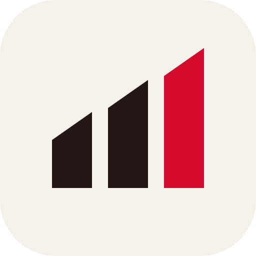

  

<h1 align="center">Commercial and financial director / product-minded developer</h1>

  Building real-estate tools, financial models, analytics and automation.

  

  

  
  
  
  

## Product ecosystem

<table>
  <tr>
    <td align="center" width="33%">
      
      <h3>MostCalc</h3>
      
Multi-project calculation and sales platform for real-estate developers.

      <a href="https://mostcalc.ru"><strong>Open product →</strong></a>
    </td>
    <td align="center" width="33%">
      
      <h3>MostFinance</h3>
      
Financial center for budgets, payment requests, registers and bank reconciliation.

      <a href="https://finance.mostcalc.ru"><strong>Open product →</strong></a>
    </td>
    <td align="center" width="33%">
      
      <h3>MostProject</h3>
      
Project modelling workspace for sales plans, scenarios and versioned forecasts.

      <a href="https://project.mostcalc.ru"><strong>Open product →</strong></a>
    </td>
  </tr>
</table>

## What I build

| Product engineering | Analytics | Automation |
| --- | --- | --- |
| React applications and calculation tools | Financial models, pricing and sales dashboards | Integrations and repeatable operational workflows |

## About

I turn complex workflows, calculations and data into clear, reliable digital
tools. I care about traceable business logic, clean UX and safe releases.

  <a href="https://mostcalc.ru">Current product</a>
  |
  <a href="https://github.com/Devvy404?tab=repositories">Repositories</a>

