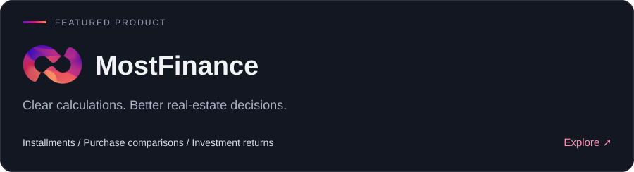
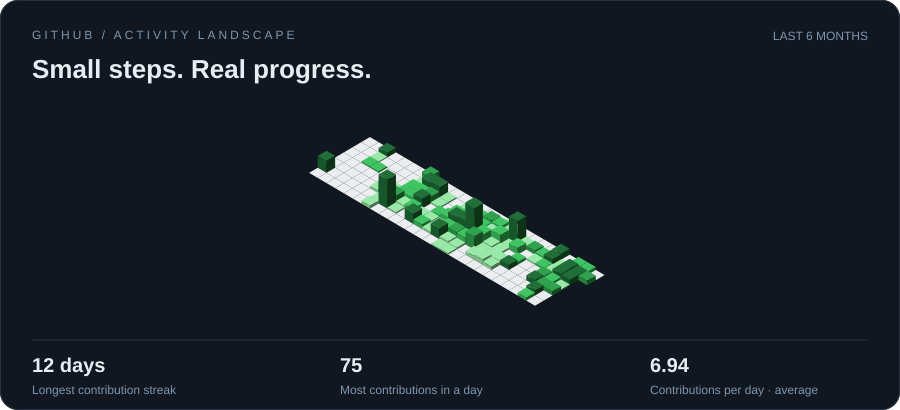

  

<h1 align="center">Business mind. Builder at heart.</h1>

  Commercial &amp; financial director · Product-minded developer 
  Building real-estate tools, financial models and automation.

 

  <a href="https://finance.mostportal.ru/"><picture><source media="(max-width: 600px)" srcset="assets/mostfinance-feature-mobile.svg"></picture></a>

<a href="https://finance.mostportal.ru/"><strong>Explore MostFinance ↗</strong></a>

 

<h3 align="center">Tools I work with</h3>

  

  

 

  <picture><source media="(max-width: 600px)" srcset="assets/activity-mobile.svg"></picture>

<picture>
  <source media="(prefers-color-scheme: dark)" srcset="assets/github-snake-dark.svg">
  <source media="(prefers-color-scheme: light)" srcset="assets/github-snake.svg">
  
</picture>

Activity powered by <a href="https://github.com/lowlighter/metrics">lowlighter/metrics</a> · Snake by <a href="https://github.com/Platane/snk">Platane/snk</a>

